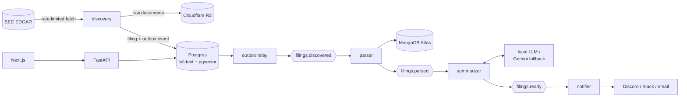

# SEC Filings Intelligence Pipeline

[](https://github.com/asood8/SEC-filings-pipeline/actions/workflows/ci.yml)

Watches SEC EDGAR for new filings from a watchlist of public companies, parses them, summarizes
free-text filings with a small LLM, makes them searchable by keyword and by meaning, and alerts
subscribed users. It runs on free tiers at $0/month, on a single arm64 VM.

> **Status:** Phase 1 is done. Phase 2 (summarization) is in progress: 8-Ks are split into their
> items, Form 4s get deterministic summaries, and history can be replayed; LLM summaries of 8-Ks
> come next. See the [build plan](docs/PROJECT_BRIEF.md#8-build-plan).

## Architecture



Each stage is a separate service connected by Redpanda (Kafka API) topics. The filing's accession
number is the idempotency key throughout. Why each piece exists:
[ADR-0001](docs/adr/0001-architecture-overview.md) and the [project brief](docs/PROJECT_BRIEF.md).

## Quickstart

Prerequisites: Docker with Compose v2, [uv](https://docs.astral.sh/uv/), and `make`. On Windows,
work inside WSL2.

```sh
make setup   # install Python 3.12, all packages, dev tools, and git hooks
make up      # start Postgres, Redpanda, Valkey, MongoDB (creates .env on first run)
make test    # run the tests (integration tests need the stack from `make up`)
make down    # stop the stack (data is kept)
```

### Running the pipeline locally

```sh
make up && make migrate                    # stack + database schema
# In .env, set SEC_CONTACT_EMAIL: SEC requires a contact address in every request's User-Agent.
# config/watchlist.toml lists the companies to follow (35 large-caps to start).
uv run filings-discovery load-companies    # SEC ticker map -> companies table, flags the watchlist
uv run filings-discovery run               # new filings -> object store + Postgres + outbox
uv run filings-outbox-relay                # outbox -> Redpanda topics (runs until Ctrl+C)
uv run filings-parser                      # filings.discovered -> MongoDB + filings.parsed
uv run filings-summarizer                  # filings.parsed -> summaries + filings.ready
uv run filings-replay parsed --form-type 4 # re-summarize history (also: discovered, to reparse)
make api                                   # http://127.0.0.1:8000/filings, docs at /docs
```

## Commands

| Command | What it does |
|---|---|
| `make setup` | First-time setup: `uv sync` plus git hooks |
| `make sync` | Install all workspace packages and dev tools into `.venv` |
| `make up` / `make down` | Start (and wait until healthy) / stop the local stack |
| `make ps` / `make logs` | Stack status / follow logs |
| `make migrate` | Apply database migrations (`uv run alembic revision --autogenerate -m "..."` creates one) |
| `make api` | Run the API locally with auto-reload |
| `make lint` | ruff (lint + format check) and mypy |
| `make fmt` | Auto-fix lint issues and format code |
| `make test` | Run all tests |

## Local services

All bound to `127.0.0.1`. Credentials are in `.env`.

| Service | Address | Production counterpart |
|---|---|---|
| Postgres 18 + pgvector | `localhost:5432` | same image on k3s |
| Redpanda (Kafka API) | `localhost:19092` | same image on k3s |
| Valkey | `localhost:6379` | same image on k3s |
| MongoDB 8.0 | `localhost:27017` | MongoDB Atlas M0 |

Details and memory budget: [ADR-0003](docs/adr/0003-local-development-stack.md).

## Repository layout

```
libs/common/          shared code (filings_common): settings, events, EDGAR client, rate limiter,
                      object store, database models + migrations, outbox relay
services/             one package per pipeline stage: discovery, parser, summarizer, notifier, api
config/               watchlist.toml: the companies discovery follows
tests/fixtures/       saved EDGAR documents for parser tests
docs/PROJECT_BRIEF.md spec, architecture, and build plan
docs/adr/             architecture decision records
docker-compose.yml    local backing services
```

`web/` (frontend), `deploy/` (Kubernetes manifests), and `infra/` (Terraform) arrive in later
phases.

## License

[MIT](LICENSE)
