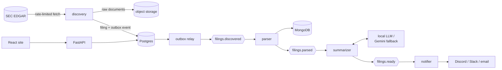

# SEC Filings Intelligence Pipeline (in progress)

[](https://github.com/asood8/SEC-filings-pipeline/actions/workflows/ci.yml)

> **Work in progress.** This project is under active development. Ingestion, parsing,
> summarization, search, the API, Google sign-in, alerts, the website, and tracing and metrics
> run end to end locally on real SEC data. The cloud deployment (Kubernetes manifests and
> Terraform) is written and validated offline but not yet applied. See [Progress](#progress).

A pipeline that watches SEC EDGAR for new filings from a watchlist of public companies, parses
them, summarizes them in plain English, makes them searchable by keyword and by meaning, and
alerts subscribed users on Discord, Slack, or email. It is designed to run indefinitely on free tiers at $0/month, on a single arm64
VM, and it's built with production practices: event-driven services, infrastructure as code,
CI, tests against real filings, and architecture decision records.

## What it does today

On a live run against EDGAR, for a watchlist of 35 large US companies:

- **Discovery** found 275 recent filings (255 Form 4 insider trades and 20 Form 8-K current
  reports). It respected SEC's fair-access rules: a declared User-Agent, and a rate limit shared
  across workers through Redis. Running it again creates no duplicates.
- **Parsing** turned every Form 4 into structured transactions and split every 8-K into its
  numbered items, plus the text of its EX-99 press releases. When an 8-K announces a call, its
  day, time, and webcast link are shown on the filing's page, in alerts, and on an Upcoming calls
  page with a calendar feed ("Q&A session: Oct 21, 2026, 5:30 pm ET, https://ir.tesla.com"):
  9 of the 22 8-Ks do, and all 9 were read correctly.
- **Insider trades** are queryable line by line (646 transactions in 256 Form 4s), and each
  insider is shown with their role ("Amy Hood (EVP, CFO)"). A filing's page lists its trades,
  and a company's page totals 90 days of insider buying and selling by owner:
  Berkshire Hathaway and Warren Buffett bought 7.5 million Lennar shares for $595 million in four
  filings. The Insider trades page ranks the largest open-market purchases and sales across all
  companies: over 90 days, the largest sale was NVIDIA director Mark A Stevens's 1.37 million
  shares for $300 million. 39 of those 47 sale filings were made under 10b5-1 plans, set up
  months ahead; leaving them out keeps the 8 discretionary sales ($591 million). Each trade shows
  how much it changed the insider's direct holdings: Tim Cook's $63.8 million sale was 5.5% of
  his, two other Apple executives' were 25% and 30% of theirs.
- **Search** finds filings by keyword (Postgres full-text search) and by meaning (pgvector
  embeddings from a local model), combined into one ranking: "trading plan cancelled" finds
  Oracle's 8-K about Larry Ellison's plan, and "debt offering" finds Amazon's note offering.
  Each result shows the passage of its summary that matches, with the query's words marked.
  Search and the feed narrow by filing date and by what an 8-K reports (2.02 results: 6;
  5.02 officer changes: 6, among them Chevron's new CFO), and a query naming a company links its
  page.
- **Following along** without signing in: Atom feeds of the latest summaries (every filing, one
  company's, one form's, or one 8-K item's) for a feed reader or Slack's RSS app, and calendar
  feeds of announced investor calls (all, or one company's). A filing's page lists what the
  company filed in the two weeks around it (PepsiCo's results next to its directors' stock
  awards), and a company's page shows its next announced call and its SEC industry.
- **Summarization** wrote every summary: Form 4s with a deterministic template, 8-Ks with an LLM
  behind a failover chain (a local model, then Gemini's free tier). Stopping the local model
  mid-run moved the remaining work to Gemini automatically, and the local model took over again
  once it was back. A grounding check flags any number in an LLM summary that doesn't appear in
  the filing, and any name the filing never uses.
- **Alerts** reached a real Discord channel: on 2026-10-08 SEC accepted an Apple Form 4 at
  18:30:32 ET; discovery found it at 18:38:44 (it polls every 10 minutes), and the alert reached
  Discord at 18:39:05, 8½ minutes after acceptance. Replaying that filing from discovery and from
  summarization sent nothing more: one alert per subscription, exactly once.

**Load test** (k6, `make loadtest`, on the development laptop with the whole stack running):
8,627 requests in 2¼ minutes, browsing rising to 100 requests/s plus 5 searches/s, with no errors.
Filing and company pages: median 4 ms, p95 18 ms; lists: p95 11 ms; 96% served from the Redis
cache. Searches: median 5 ms; the slowest 5% take about 2 s, because a search the cache hasn't
seen waits at most 2 s for the CPU-only embedding model before answering from keywords alone.

**Model benchmark** (`filings-benchmark`, llama3.2:3b on the laptop's CPU, all 22 local 8-Ks,
each labeled by hand with the facts a correct summary states and the claims the filing
contradicts): all 22 summarized, median 46 s, p95 109 s. The summaries state 86% of the labeled
facts. 5 of 22 make a claim the filing contradicts, such as "Oracle cancels Larry Ellison's plan"
(Ellison cancelled it himself) or a year-to-date growth rate given as the quarter's, and 2 contain
a number the filing doesn't (the grounding check flags those). A prompt with explicit rules against
those slips didn't reduce them ([ADR-0010](docs/adr/0010-local-llm-in-compose-and-default-model.md)).

**Search quality** (`filings-search-eval`, 20 labeled queries over the local filings): hybrid
search (the default) ranks a relevant filing first for every query (mean reciprocal rank 1.00)
and finds 97% of the relevant filings in its top 10. Weighting Form 4s' semantic matches at half
cut their share of the top 5, for queries about other forms, from 54% to 30%. Keyword search's
mean reciprocal rank went from 0.83 to 0.94 once it learned other words for what summaries say
("CFO" for "Chief Financial Officer", "purchase" for "bought") and stopped matching Costco's
ticker COST for "costs"; "stock" for "shares" took "stock gift" from one of seven gifts to all
seven ([ADR-0011](docs/adr/0011-search-and-public-api.md)).

**Query plans at volume** (`scripts/synthetic_data.py` and `scripts/measure_queries.py`, on
synthetic data for 500 companies over 10 years: 452,000 filings, 13 times what the watchlist
gathers in a decade): every page of the feed takes under 2 ms of SQL after an index fix (it used
to sort all filings: 249 ms), and filtered semantic search fills its pages (an 8-K filter returned
nothing at that volume). Keyword search for a word most documents contain still takes 1–2 s there
([runbook, "Capacity planning"](docs/runbook.md#capacity-planning)).

Example headlines from that run (public filings):

- *Douglas J Herrington sold 1,000 AMZN shares for $251.5K (avg $251.50/share)* (Form 4)
- *Berkshire Hathaway Inc and Warren E Buffett bought 2,668,508 shares of Class A Common Stock
  (LEN) for $206.7M* (Form 4)
- *Adobe Inc. Reports Record Q3 Fiscal Year 2026 Results and Raises Full Year Targets* (8-K, with
  its press release)
- *Tesla, Inc. Reports Third Quarter 2026 Production, Deliveries, and Deployments* (8-K)

> Summaries are generated automatically and may contain errors. They are not investment advice;
> always check the original filing, linked from every record.

## Progress

| Phase | Scope | Status |
|---|---|---|
| 0. Foundations | Monorepo, local stack, CI, ADRs | Done |
| 1. Thin vertical slice | EDGAR client, discovery, outbox relay, Form 4 parser, `GET /filings` | Done |
| 2. Summarization | 8-K items and exhibits, Form 4 template, LLM failover, replay | Done |
| 3. Search and API | Full-text and semantic search (pgvector), caching, rate limiting | Done |
| 4. Users and alerts | Google sign-in, subscriptions, Discord/Slack/email alerts | Done |
| 5. Frontend | React site (Vite + TypeScript) on Cloudflare Pages | Done |
| 6. Observability | OpenTelemetry traces, metrics, Grafana dashboards and alerts | Done |
| 7. Production | Terraform, k3s on Oracle Cloud's free tier, Argo CD, multi-arch images | In progress: images and their CI build and deploy, Kubernetes manifests (sealed secrets, Argo CD), and Terraform written and validated offline; nothing applied yet (needs cloud accounts and a domain) |
| 8. Hardening | Load tests, local-model benchmark, backups, runbook | In progress: k6 load test, model benchmark tool, search-quality evaluation, backup restore drill, outbox pruning and capacity planning, runbook, dependency audit; the runs on the production VM (benchmark, load test, first backup) are still to do |

The full plan is in the [project brief](docs/PROJECT_BRIEF.md#8-build-plan).

## Architecture



This is the target design. Everything except the cloud deployment runs locally today.

Each stage is a separate service connected by Redpanda (Kafka API) topics. Some design choices
worth a look:

- **Transactional outbox.** Every event is written in the same database transaction as the change
  it announces, so a crash can't lose an event or emit a phantom one.
  ([ADR-0004](docs/adr/0004-service-runtime-libraries-and-patterns.md))
- **Idempotency on the accession number.** Redeliveries and full replays never duplicate filings
  or announcements. ([ADR-0007](docs/adr/0007-8k-items-summaries-and-replay.md))
- **One SEC rate limit for all workers.** A token bucket in Redis, updated by an atomic Lua
  script. ([ADR-0004](docs/adr/0004-service-runtime-libraries-and-patterns.md))
- **LLM failover with circuit breakers**, plus a deterministic grounding check on every LLM
  summary. ([ADR-0008](docs/adr/0008-llm-providers-failover-and-exhibits.md),
  [ADR-0009](docs/adr/0009-grounding-check-for-llm-summaries.md))
- **Exactly-once alerts**: one notification row per (subscription, filing), delivered under a
  row lock, so redeliveries and full replays never alert twice; webhook targets are restricted
  to official Discord and Slack URLs. Form 4 alerts can be narrowed to open-market trades or
  purchases, above a dollar value, so routine filings (tax withholding, awards) stay quiet, and
  8-K alerts to chosen items (earnings, officer changes, ...). Keyword alerts watch for words
  ("buyback", "resign OR retire") in one company's filings or every watchlist company's. Before
  saving, a preview lists the recent filings the settings would have sent, matched exactly as the
  notifier matches (Apple alerts: 15 in 90 days, 8 with open-market trades only), and an alert
  says which of yours sent it when the filing alone doesn't.
  ([ADR-0012](docs/adr/0012-notifier-and-exactly-once-alerts.md))
- **Sign-in without handling passwords**: Google's ID token is verified against Google's
  published keys, then exchanged for the API's own HttpOnly session cookie; only a hash of each
  session token is stored. ([ADR-0013](docs/adr/0013-sign-in-and-sessions.md))
- **One trace per filing**: the outbox stores each event's trace context and Kafka headers carry
  it, so a single OpenTelemetry trace follows a filing from discovery through every service to
  its alert. ([ADR-0016](docs/adr/0016-observability.md))
- **Hybrid search in Postgres**: full-text and vector results merged with reciprocal rank
  fusion, degrading to keywords when the embedding model is down.
  ([ADR-0011](docs/adr/0011-search-and-public-api.md))
- **Security reviewed**: request bodies capped before they are read, mail sent over verified
  TLS, model text escaped in every channel and feed, sessions hashed and CSRF-checked, every
  GitHub Action pinned to a commit, and pods that run as non-root with read-only filesystems, no
  capabilities, and network policies. ([ADR-0013](docs/adr/0013-sign-in-and-sessions.md),
  [ADR-0012](docs/adr/0012-notifier-and-exactly-once-alerts.md),
  [ADR-0019](docs/adr/0019-image-ci-and-deploy.md),
  [ADR-0017](docs/adr/0017-kubernetes-manifests.md))

Every component's reason for existing is recorded in the
[architecture decision records](docs/adr/README.md).

## Quickstart

Prerequisites: Docker with Compose v2, [uv](https://docs.astral.sh/uv/), and `make`, plus
[Node.js 24](https://nodejs.org/) for the website. On Windows, work inside WSL2.

```sh
make setup   # install Python 3.12, all packages, dev tools, and git hooks
make up      # start Postgres, Redpanda, Valkey, MongoDB (creates .env on first run)
make test    # run the tests (integration tests need the stack from `make up`)
make down    # stop the stack (data is kept)
```

### Running the pipeline locally

SEC requires every automated request to identify its sender. Before running anything that
contacts SEC, set **your own** contact email as `SEC_CONTACT_EMAIL` in `.env`.

```sh
make up && make migrate                    # stack + database schema
uv run filings-discovery load-companies    # SEC ticker map -> companies; flags config/watchlist.toml
uv run filings-discovery run               # new filings -> object store + Postgres + outbox
uv run filings-outbox-relay                # outbox -> Redpanda topics (runs until Ctrl+C)
uv run filings-parser                      # filings.discovered -> MongoDB + filings.parsed
uv run filings-summarizer                  # filings.parsed -> summaries + filings.ready
uv run filings-notifier                    # filings.ready -> Discord / Slack / email alerts
uv run filings-index                       # build the search index (embeddings need EMBEDDING_MODEL)
make api                                   # http://127.0.0.1:8000, interactive docs at /docs
make web-install && make web               # the website on http://localhost:3000
```

Or run every stage at once, with discovery every 10 minutes: `make pipeline` (Ctrl+C stops it).

To watch traces and metrics: `make obs-up`, set `OTEL_EXPORTER_OTLP_ENDPOINT=http://localhost:4318`
in `.env` (see `.env.example`), restart the services, and open http://localhost:3001 (dashboards
"SEC Filings: Pipeline" and "SEC Filings: API"; traces under Explore, Tempo). With the endpoint
unset, telemetry is off and costs nothing.

Sign-in needs a Google OAuth client ID (Google Cloud console, APIs & Services, Credentials: a
"Web application" client with `http://localhost` and `http://localhost:3000` as authorized
JavaScript origins; no secret needed) in `.env` as `GOOGLE_CLIENT_ID`. Open the website as
`localhost`, not `127.0.0.1`, so the session cookie is shared with the API.

The API: `GET /search?q=...` (hybrid by default; `mode=keyword|semantic`), `GET /filings` (both
take `form_type`, `cik`, and filing dates `since`/`until`; `/filings` and the Atom feed also
take an 8-K `item`, e.g. `5.02` for officer changes),
`GET /filings/{accession_no}` (with a Form 4's transaction lines), `GET /companies`,
`GET /companies/{ticker}`, `GET /companies/{ticker}/insider-activity?days=90` (insiders'
purchases and sales per owner, grouped by owner CIK), `GET /insider-trades?side=buy&days=30`
(the largest purchases or sales across companies, one row per Form 4; `include_planned=false`
leaves out 10b5-1 plan trades), and `GET /calls?days=60`
(the earnings calls and other investor events 8-Ks announce, also as an iCalendar feed to
subscribe to, `GET /calls.ics`; both take `ticker` for one company's). `GET /feeds/filings.atom` (optionally `cik`, `form_type`) is
the latest summarized filings as an Atom feed, for a feed reader. A Form 4's reporting
owners come with the name as filed and a readable one ("COOK TIMOTHY D" as "Timothy D Cook"),
and with who they are to the company: a short `relationship` ("Executive Chair, Director",
"EVP, CFO", "10% owner") and the filing's boxes and titles as filed (`is_director`,
`is_officer`, `officer_title`, `is_ten_percent_owner`, `is_other`, `other_text`). Lists use cursor
pagination, and responses are cached briefly and rate-limited per client through Redis. Signed
in: `POST /auth/google`, `POST /auth/logout`, `GET`/`DELETE /me`, and alert subscriptions at
`/subscriptions` (`POST /subscriptions/batch` adds several companies and destinations at once;
`GET /subscriptions/preview` lists the recent filings an alert's settings would have sent).

8-K summaries need an LLM: set `GEMINI_API_KEY` (free from Google AI Studio, no billing needed)
and/or a local model. `make llm-up` runs Ollama in Docker and pulls `llama3.2:3b` and the
`nomic-embed-text:v1.5` embedding model; then set `LLM_MODEL=llama3.2:3b` and
`EMBEDDING_MODEL=nomic-embed-text:v1.5`. Form 4 summaries need neither. Other tools:

```sh
uv run filings-discovery fetch-exhibits    # download EX-99 exhibits for 8-Ks found before exhibits
uv run filings-replay parsed --form-type 4 # re-summarize history (also: discovered, to reparse)
uv run filings-rebuild-key-fields --form-type 4  # refill Form 4 key fields from MongoDB
```

## Commands

| Command | What it does |
|---|---|
| `make setup` | First-time setup: `uv sync` plus git hooks |
| `make sync` | Install all workspace packages and dev tools into `.venv` |
| `make up` / `make down` | Start (and wait until healthy) / stop the local stack |
| `make ps` / `make logs` | Stack status / follow logs |
| `make llm-up` / `make llm-down` | Start (and pull the default LLM and embedding models) / stop the optional local LLM |
| `make migrate` | Apply database migrations (`uv run alembic revision --autogenerate -m "..."` creates one) |
| `make api` | Run the API locally with auto-reload |
| `make pipeline` | Run every pipeline stage locally, with discovery every 10 minutes |
| `make images` | Build the service container images (`make image-api` builds one) |
| `make lint` | ruff (lint + format check) and mypy |
| `make fmt` | Auto-fix lint issues and format code |
| `make test` | Run all tests |
| `make web-install` / `make web` | Install the website's dependencies / run it with hot reload on :3000 |
| `make web-check` | Lint, type-check, test, and build the website |
| `make web-types` | Regenerate the website's API types from the API's OpenAPI schema |
| `make tf-check` / `make tf-fmt` | Check the Terraform code (fmt, validate, tests on mock providers, free-tier allowlist) / format it |
| `make tf-init` / `make tf-plan` / `make tf-apply` | Production: connect to the state in R2, plan from `production.tfvars` into `production.tfplan`, apply exactly that plan ([infra/terraform/README.md](infra/terraform/README.md#first-apply)) |
| `scripts/retry-vm-capacity.sh` | Retry creating the A1 VM through "Out of host capacity" every minute, at 2 OCPU/12 GB or 1/6 (`SIZES`), rotating availability domains and applying only plans that create the instance, then finish it (volume, attachment, Atlas access) and grow a smaller VM once a capacity report says there is room ([runbook](docs/runbook.md#oracle-idle-reclamation-and-capacity-errors), ADR-0020) |
| `uv run filings-r2-usage` | Check R2's free tier with Cloudflare's own numbers (`CLOUDFLARE_ACCOUNT_ID`, `CLOUDFLARE_ANALYTICS_TOKEN`); a daily job in production |
| `make k8s-tools` / `make k8s-check` | Install kubectl, kubeconform, and kubeseal (checksums verified) / render and validate the Kubernetes manifests |
| `make obs-up` / `make obs-down` | Start / stop the optional local trace and metrics viewer (Grafana on :3001) |
| `make loadtest` | Load-test a running API with k6 (`make api-loadtest` runs the API with rate limits raised) |
| `make backup-drill` | Dump the local database, restore it into a throwaway database, and check every table matches |
| `make audit` | Check the locked Python and website dependencies for known vulnerabilities |
| `uv run filings-benchmark --model <name>` | Compare 8-K summarization across models: latency, failures, fact recall and forbidden claims (labeled 8-Ks), grounding |
| `uv run filings-search-eval` | Score keyword, semantic, and hybrid search against labeled queries (`config/search_eval.json`) |
| `uv run filings-replay discovered --accession <no>` | Reprocess one filing (also `--form-type`, `--status`, or `parsed`) |
| `uv run filings-rebuild-key-fields --form-type 4` | Rewrite parsed filings' Postgres key fields (Form 4 owner CIKs and transaction lines too) from their MongoDB payloads, after a key-field change; no SEC calls, no events |
| `uv run python scripts/synthetic_data.py --create --database-url <throwaway>` | Fill a throwaway database with years of synthetic, production-shaped data (resumes if interrupted; `--drop` deletes it) |
| `uv run python scripts/measure_queries.py --database-url <throwaway>` | Time and explain every regular query on it, flagging sequential scans of large tables |
| `uv run filings-healthcheck <process>` | The workers' liveness check (e.g. `filings-parser`): exits 1 if its loop stopped beating |

## Local services

All bound to `127.0.0.1`. Credentials are throwaway local values in `.env`.

| Service | Address | Production counterpart |
|---|---|---|
| Postgres 18 + pgvector | `localhost:5432` | same image on k3s |
| Redpanda (Kafka API) | `localhost:19092` | same image on k3s |
| Valkey | `localhost:6379` | same image on k3s |
| MongoDB 8.0 | `localhost:27017` | MongoDB Atlas M0 |
| Ollama (optional, `make llm-up`) | `localhost:11434` | llama.cpp server on k3s |
| Grafana + Tempo + Prometheus (optional, `make obs-up`) | `localhost:3001` | Grafana Cloud |

Details and memory budget: [ADR-0003](docs/adr/0003-local-development-stack.md).

## Repository layout

```
libs/common/          shared code (filings_common): settings, events, EDGAR client, rate limiter,
                      object store, database models + migrations, outbox relay, consume loop
services/             one package per pipeline stage: discovery, parser, summarizer, notifier, api
config/               watchlist.toml: the companies discovery follows
web/                  the website: Vite + React + TypeScript, static files for Cloudflare Pages
tests/fixtures/       real EDGAR documents used by the parser tests
docs/PROJECT_BRIEF.md spec, architecture, and build plan
docs/adr/             architecture decision records
docs/runbook.md       operating the production system: alerts, deploys, secrets, backups
docker/               the Dockerfile for the service images
scripts/              helpers for `make pipeline`, `backup-drill`, `k8s-tools`, and `k8s-check`;
                      synthetic data and query measurements at volume
deploy/               Kubernetes manifests (Kustomize, Sealed Secrets, Argo CD), and Grafana
                      dashboards and alert rules
.github/workflows/    CI, image builds and deploys, the dependency audit
infra/terraform/      the cloud resources outside the cluster, for $0 a month (see its README)
loadtest/             the k6 load test of the API
docker-compose.yml    local backing services
```

## License

[MIT](LICENSE). Filing content in `tests/fixtures/` comes from SEC EDGAR, which is public.
