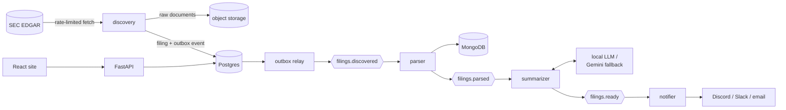

# SEC Filings Intelligence Pipeline (in progress)

[](https://github.com/asood8/SEC-filings-pipeline/actions/workflows/ci.yml)

> **Work in progress.** This project is under active development. Ingestion, parsing,
> summarization, search, the API, Google sign-in, alerts, and the website run end to end locally
> on real SEC data; the cloud deployment is still to come. See [Progress](#progress).

A pipeline that watches SEC EDGAR for new filings from a watchlist of public companies, parses
them, summarizes them in plain English, makes them searchable by keyword and by meaning, and
alerts subscribed users on Discord, Slack, or email. It is designed to run indefinitely on free tiers at $0/month, on a single arm64
VM, and it's built with production practices: event-driven services, infrastructure as code,
CI, tests against real filings, and architecture decision records.

## What it does today

On a live run against EDGAR, for a watchlist of 35 large US companies:

- **Discovery** found 275 recent filings (255 Form 4 insider trades and 20 Form 8-K current
  reports). It respected SEC's fair-access rules: a declared User-Agent, and a rate limit shared
  across workers through Redis. Running it again creates no duplicates.
- **Parsing** turned every Form 4 into structured transactions and split every 8-K into its
  numbered items, plus the text of its EX-99 press releases.
- **Search** finds filings by keyword (Postgres full-text search) and by meaning (pgvector
  embeddings from a local model), combined into one ranking: "trading plan cancelled" finds
  Oracle's 8-K about Larry Ellison's plan, and "debt offering" finds Amazon's note offering.
- **Summarization** wrote every summary: Form 4s with a deterministic template, 8-Ks with an LLM
  behind a failover chain (a local model, then Gemini's free tier). Stopping the local model
  mid-run moved the remaining work to Gemini automatically, and the local model took over again
  once it was back. A grounding check flags any number in an LLM summary that doesn't appear in
  the filing.

Example headlines from that run (public filings):

- *Douglas J Herrington sold 1,000 AMZN shares for $251.5K (avg $251.50/share)* (Form 4)
- *Berkshire Hathaway Inc and Warren E Buffett bought 2,668,508 shares of Class A Common Stock
  (LEN) for $206.7M* (Form 4)
- *Adobe Inc. Reports Record Q3 Fiscal Year 2026 Results and Raises Full Year Targets* (8-K, with
  its press release)
- *Tesla, Inc. Reports Third Quarter 2026 Production, Deliveries, and Deployments* (8-K)

> Summaries are generated automatically and may contain errors. They are not investment advice;
> always check the original filing, linked from every record.

## Progress

| Phase | Scope | Status |
|---|---|---|
| 0. Foundations | Monorepo, local stack, CI, ADRs | Done |
| 1. Thin vertical slice | EDGAR client, discovery, outbox relay, Form 4 parser, `GET /filings` | Done |
| 2. Summarization | 8-K items and exhibits, Form 4 template, LLM failover, replay | Done |
| 3. Search and API | Full-text and semantic search (pgvector), caching, rate limiting | Done |
| 4. Users and alerts | Google sign-in, subscriptions, Discord/Slack/email alerts | In progress: all built; waiting for a real new filing to reach Discord |
| 5. Frontend | React site (Vite + TypeScript) on Cloudflare Pages | In progress: every page built and working against the local API |
| 6. Observability | OpenTelemetry traces, metrics, Grafana dashboards and alerts | Planned |
| 7. Production | Terraform, k3s on Oracle Cloud's free tier, Argo CD, multi-arch images | Started: service images build (amd64; arm64-ready) |
| 8. Hardening | Load tests, local-model benchmark, backups, runbook | Planned |

The full plan is in the [project brief](docs/PROJECT_BRIEF.md#8-build-plan).

## Architecture



This is the target design. Everything except the cloud deployment runs locally today.

Each stage is a separate service connected by Redpanda (Kafka API) topics. Some design choices
worth a look:

- **Transactional outbox.** Every event is written in the same database transaction as the change
  it announces, so a crash can't lose an event or emit a phantom one.
  ([ADR-0004](docs/adr/0004-service-runtime-libraries-and-patterns.md))
- **Idempotency on the accession number.** Redeliveries and full replays never duplicate filings
  or announcements. ([ADR-0007](docs/adr/0007-8k-items-summaries-and-replay.md))
- **One SEC rate limit for all workers.** A token bucket in Redis, updated by an atomic Lua
  script. ([ADR-0004](docs/adr/0004-service-runtime-libraries-and-patterns.md))
- **LLM failover with circuit breakers**, plus a deterministic grounding check on every LLM
  summary. ([ADR-0008](docs/adr/0008-llm-providers-failover-and-exhibits.md),
  [ADR-0009](docs/adr/0009-grounding-check-for-llm-summaries.md))
- **Exactly-once alerts**: one notification row per (subscription, filing), delivered under a
  row lock, so redeliveries and full replays never alert twice; webhook targets are restricted
  to official Discord and Slack URLs. ([ADR-0012](docs/adr/0012-notifier-and-exactly-once-alerts.md))
- **Sign-in without handling passwords**: Google's ID token is verified against Google's
  published keys, then exchanged for the API's own HttpOnly session cookie; only a hash of each
  session token is stored. ([ADR-0013](docs/adr/0013-sign-in-and-sessions.md))
- **Hybrid search in Postgres**: full-text and vector results merged with reciprocal rank
  fusion, degrading to keywords when the embedding model is down.
  ([ADR-0011](docs/adr/0011-search-and-public-api.md))

Every component's reason for existing is recorded in the
[architecture decision records](docs/adr/README.md).

## Quickstart

Prerequisites: Docker with Compose v2, [uv](https://docs.astral.sh/uv/), and `make`, plus
[Node.js 24](https://nodejs.org/) for the website. On Windows, work inside WSL2.

```sh
make setup   # install Python 3.12, all packages, dev tools, and git hooks
make up      # start Postgres, Redpanda, Valkey, MongoDB (creates .env on first run)
make test    # run the tests (integration tests need the stack from `make up`)
make down    # stop the stack (data is kept)
```

### Running the pipeline locally

SEC requires every automated request to identify its sender. Before running anything that
contacts SEC, set **your own** contact email as `SEC_CONTACT_EMAIL` in `.env`.

```sh
make up && make migrate                    # stack + database schema
uv run filings-discovery load-companies    # SEC ticker map -> companies; flags config/watchlist.toml
uv run filings-discovery run               # new filings -> object store + Postgres + outbox
uv run filings-outbox-relay                # outbox -> Redpanda topics (runs until Ctrl+C)
uv run filings-parser                      # filings.discovered -> MongoDB + filings.parsed
uv run filings-summarizer                  # filings.parsed -> summaries + filings.ready
uv run filings-notifier                    # filings.ready -> Discord / Slack / email alerts
uv run filings-index                       # build the search index (embeddings need EMBEDDING_MODEL)
make api                                   # http://127.0.0.1:8000, interactive docs at /docs
make web-install && make web               # the website on http://localhost:3000
```

Or run every stage at once, with discovery every 10 minutes: `make pipeline` (Ctrl+C stops it).

Sign-in needs a Google OAuth client ID (Google Cloud console, APIs & Services, Credentials: a
"Web application" client with `http://localhost` and `http://localhost:3000` as authorized
JavaScript origins; no secret needed) in `.env` as `GOOGLE_CLIENT_ID`. Open the website as
`localhost`, not `127.0.0.1`, so the session cookie is shared with the API.

The API: `GET /search?q=...` (hybrid by default; `mode=keyword|semantic`), `GET /filings`,
`GET /filings/{accession_no}`, `GET /companies`, and `GET /companies/{ticker}`. Lists use cursor
pagination, and responses are cached briefly and rate-limited per client through Redis. Signed in:
`POST /auth/google`, `POST /auth/logout`, `GET`/`DELETE /me`, and alert subscriptions at
`/subscriptions` (`POST /subscriptions/batch` adds several companies and destinations at once).

8-K summaries need an LLM: set `GEMINI_API_KEY` (free from Google AI Studio, no billing needed)
and/or a local model. `make llm-up` runs Ollama in Docker and pulls `llama3.2:3b` and the
`nomic-embed-text:v1.5` embedding model; then set `LLM_MODEL=llama3.2:3b` and
`EMBEDDING_MODEL=nomic-embed-text:v1.5`. Form 4 summaries need neither. Other tools:

```sh
uv run filings-discovery fetch-exhibits    # download EX-99 exhibits for 8-Ks found before exhibits
uv run filings-replay parsed --form-type 4 # re-summarize history (also: discovered, to reparse)
```

## Commands

| Command | What it does |
|---|---|
| `make setup` | First-time setup: `uv sync` plus git hooks |
| `make sync` | Install all workspace packages and dev tools into `.venv` |
| `make up` / `make down` | Start (and wait until healthy) / stop the local stack |
| `make ps` / `make logs` | Stack status / follow logs |
| `make llm-up` / `make llm-down` | Start (and pull the default model) / stop the optional local LLM |
| `make migrate` | Apply database migrations (`uv run alembic revision --autogenerate -m "..."` creates one) |
| `make api` | Run the API locally with auto-reload |
| `make pipeline` | Run every pipeline stage locally, with discovery every 10 minutes |
| `make images` | Build the service container images (`make image-api` builds one) |
| `make lint` | ruff (lint + format check) and mypy |
| `make fmt` | Auto-fix lint issues and format code |
| `make test` | Run all tests |
| `make web-install` / `make web` | Install the website's dependencies / run it with hot reload on :3000 |
| `make web-check` | Lint, type-check, test, and build the website |
| `make web-types` | Regenerate the website's API types from the API's OpenAPI schema |

## Local services

All bound to `127.0.0.1`. Credentials are throwaway local values in `.env`.

| Service | Address | Production counterpart |
|---|---|---|
| Postgres 18 + pgvector | `localhost:5432` | same image on k3s |
| Redpanda (Kafka API) | `localhost:19092` | same image on k3s |
| Valkey | `localhost:6379` | same image on k3s |
| MongoDB 8.0 | `localhost:27017` | MongoDB Atlas M0 |
| Ollama (optional, `make llm-up`) | `localhost:11434` | llama.cpp server on k3s |

Details and memory budget: [ADR-0003](docs/adr/0003-local-development-stack.md).

## Repository layout

```
libs/common/          shared code (filings_common): settings, events, EDGAR client, rate limiter,
                      object store, database models + migrations, outbox relay, consume loop
services/             one package per pipeline stage: discovery, parser, summarizer, notifier, api
config/               watchlist.toml: the companies discovery follows
web/                  the website: Vite + React + TypeScript, static files for Cloudflare Pages
tests/fixtures/       real EDGAR documents used by the parser tests
docs/PROJECT_BRIEF.md spec, architecture, and build plan
docs/adr/             architecture decision records
docker/               the Dockerfile for the service images
scripts/              development helpers (`make pipeline`)
docker-compose.yml    local backing services
```

`deploy/` (Kubernetes manifests) and `infra/` (Terraform) arrive in later phases.

## License

[MIT](LICENSE). Filing content in `tests/fixtures/` comes from SEC EDGAR, which is public.
