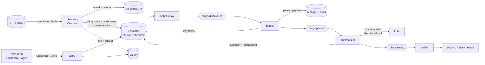

# ADR-0001: Architecture overview

- **Status:** Accepted
- **Date:** 2026-10-05

## Context

The system watches SEC EDGAR for new filings from a watchlist of companies, parses them,
summarizes free-text filings with a small LLM, makes them searchable, and alerts subscribed users.
The full specification is in [`docs/PROJECT_BRIEF.md`](../PROJECT_BRIEF.md).

The forces that shape the architecture:

- **Purpose.** It is a portfolio project meant to show breadth: real industry components, each with
  a concrete job, run with production practices.
- **Cost.** It must run indefinitely at $0/month on free tiers, with or without users.
- **Hardware.** Production is one Oracle Cloud Always Free VM: arm64, 2 OCPU, 12 GB RAM.
- **SEC fair access.** At most 10 requests/second across the whole system, with a declared
  User-Agent.
- **Uneven stage speeds.** Fetching and parsing take milliseconds per filing; an LLM summary on a
  small CPU-only VM takes seconds to minutes.
- **Free tiers change.** Any provider may tighten limits or disappear.

## Decision

We will build an event-driven pipeline of small services on a single-node Kubernetes cluster.

1. **Separate services connected by Redpanda topics** (`filings.discovered` → `filings.parsed` →
   `filings.ready`, each with a dead-letter topic). The slow summarizer never holds up discovery or
   parsing; the backlog simply waits in the topic. Retained topics also allow **replay**: when the
   model or prompt changes, history is re-summarized by re-reading the topic. Events carry IDs and
   pointers, not documents, and are keyed by accession number.
2. **Transactional outbox.** Discovery writes the filing row and its event in one Postgres
   transaction; a relay publishes the event afterwards. A crash can't produce a filing without an
   event, or an event without a filing.
3. **Idempotency on the accession number.** It is the natural key everywhere: unique constraints,
   upserting consumers, and one notification per (subscription, filing) even across replays.
4. **Each store does one job.**
   - Postgres: relational data, pipeline state, keyword search, and semantic search via pgvector.
   - MongoDB Atlas: parsed payloads, whose shape differs by form type.
   - Cloudflare R2: raw filings, so reparsing never re-hits SEC.
   - Valkey: the global SEC rate limit, API rate limiting, caching, and short-lived dedupe.
5. **LLM behind an interface.** A `Summarizer` interface with a local OpenAI-compatible provider
   (Ollama in dev, llama.cpp server in prod) and a Gemini free-tier fallback behind a circuit
   breaker. Form 4 gets a deterministic template and never touches the LLM.
6. **One shared EDGAR client** for every SEC request: declared User-Agent, a Valkey token bucket
   (default 5 req/s, half SEC's maximum) shared by all workers, and backoff on 429/503.
7. **Runtime and delivery.** k3s on the Oracle VM. Terraform describes all infrastructure; Argo CD
   syncs the cluster from Kubernetes manifests in git; GitHub Actions builds multi-arch images to
   GHCR. Cloudflare Tunnel exposes the API without open ports, and Cloudflare Pages hosts the static
   frontend. OpenTelemetry sends traces, metrics, and logs to Grafana Cloud.
8. **Portability.** Provider-specific code (object storage, LLM) sits behind interfaces, and all
   infrastructure is in Terraform, so a provider change touches adapters and config, not business
   logic. The brief's §11 describes the fallback deployments.

## Alternatives considered

- **A single application with an in-process job queue and cron.** At this data volume (tens of
  companies, a few hundred filings a day) one process would cope. It loses the properties the split
  buys: isolating the slow LLM stage, replaying history through topics, and independent consumers.
  It would also hide the distributed-systems patterns the project exists to demonstrate.
- **Postgres as the queue** (`SELECT ... FOR UPDATE SKIP LOCKED`). Fewer moving parts, but no
  consumer groups or offset-based replay, so replay would have to be built by hand.
- **Postgres JSONB instead of MongoDB.** JSONB would store the parsed payloads well. Atlas M0 wins
  because it runs off the VM, keeping bulky payloads out of the 12 GB memory budget, and because it
  adds a document store where varying document shapes justify one.
- **Serverless (Cloud Run, Pub/Sub, Neon).** No VM to manage, but cold starts, tighter free-tier
  quotas, and less infrastructure to own. It is kept as the fallback if Oracle capacity is
  unavailable.
- **AWS free tier.** New accounts' free plan ends after six months, which breaks the $0
  indefinitely goal.

## Consequences

- **More moving parts to operate.** Infrastructure-as-code, GitOps, health checks, and tracing
  across services are there to keep that manageable.
- **No high availability.** One node is a single point of failure; this is an explicit non-goal.
- **Tight memory.** The target is at most 9 GB of the VM's 12 GB, so every workload gets requests
  and limits, and the brief's estimates must be replaced with measurements.
- **Eventual consistency across stores.** Postgres is the source of truth for pipeline state
  (`filings.status`); Mongo, R2, and topics are derived or pointed to from it.
- **Dependence on free tiers.** Interfaces, Terraform, and the fallback plan bound the cost of a
  provider change.

## Tools in plain language

- **Redpanda:** a message broker that speaks Kafka's protocol, in a single lightweight binary. Each
  stage writes events to a topic and the next stage reads them at its own pace. Events stay stored,
  so they can be read again later.
- **Transactional outbox:** a pattern, not a product. You write the event to a database table in the
  same transaction as the data change, and a separate process forwards it to the broker.
- **pgvector:** a Postgres extension that stores embeddings (lists of numbers that capture meaning)
  and finds the nearest ones, which powers "search by meaning".
- **Valkey:** an open-source, Redis-compatible in-memory key-value store.
- **k3s:** a lightweight Kubernetes distribution that fits on a single small VM.
- **Argo CD:** watches the git repo and makes the cluster match the manifests in it ("GitOps").
- **Terraform:** describes cloud resources in code so the whole environment can be rebuilt with one
  command.
- **Cloudflare Tunnel:** an outbound connection from the VM to Cloudflare, so the API is reachable
  over HTTPS without opening inbound ports.
- **OpenTelemetry:** a vendor-neutral standard and SDK for traces, metrics, and logs. A trace follows
  one filing across every service.
